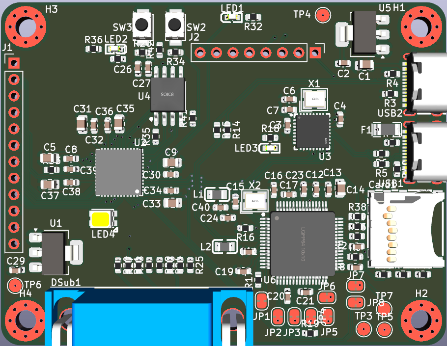

# Icey

an Uno shaped FPGA ICE40 UP5K board for learning!

it features:
- integrated VGA connector with display out
- integrated USB peripheral support (such as keyboards!)
- programming with usb C via JTAG or UART
- QSPI flash
- micro SD card
- header pins broken out for extra features
- LEDs
- buttons

# PCB

# Schematic

# BOM

| Item     | Qty | Price (USD)  |   |   |
|----------|-----|--------------|---|---|
| PCB      | 5   | 7.00          |   |   |
| Assembly | 2   | 106.51       |   |   |