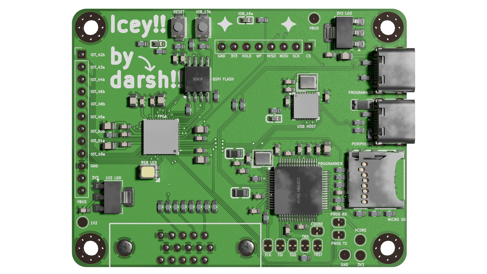
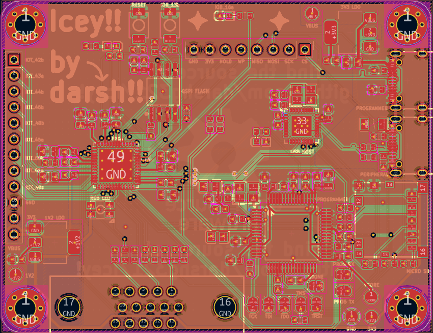
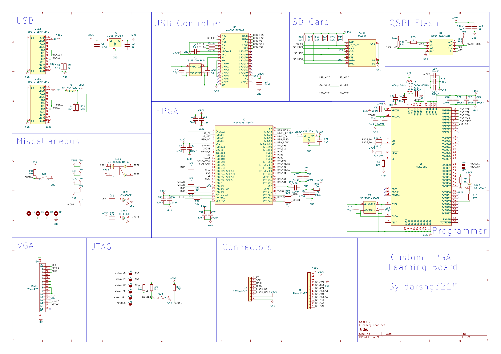

# Icey

an Uno-sized FPGA iCE40-UP5K board for learning!

it features:
- integrated VGA connector with display out
- integrated USB peripheral support (such as keyboards!)
- programming with usb C via JTAG or UART
- QSPI flash
- micro SD card
- header pins broken out for extra features
- LEDs
- buttons

# Firmware

Tools, examples and bring-up notes for the real board are in [`firmware/`](firmware/README.md),
including a checklist of which features have been tested on hardware. Quick demo:

```sh
git clone --recurse-submodules https://github.com/darshg321/Icey && cd Icey
./firmware/life-demo.sh
```

# PCB





# Schematic



## Headers

| Pin | Net | FPGA |
|---|---|---|
| 1 | `IOT_42b` | `31` |
| 2 | `IOT_43a` | `32` |
| 3 | `IOT_44b` | `34` |
| 4 | `IOT_46b_G0` | `35` |
| 5 | `IOT_48b` | `36` |
| 6 | `IOT_45a_G1` | `37` |
| 7 | `IOT_50b` | `38` |
| 8 | `IOT_51a` | `42` |
| 9 | `IOT_49a` | `43` |
| 10 | GND | — |
| 11 | +3V3 | — |
| 12 | VBUS (+5V) | — |

### Configuration SPI

| Pin | Net | | Pin | Net |
|---|---|---|---|---|
| 1 | `CS` | | 5 | `FLASH_WP` |
| 2 | `SCK` | | 6 | `FLASH_HOLD` |
| 3 | `MOSI` | | 7 | **+3V3** |
| 4 | `MISO` | | 8 | **GND** |

# BOM

| Item     | Qty | Price (USD)  |
|----------|-----|--------------|
| PCB      | 5   | 7.00         |
| Assembly | 2   | 106.51       |


### Contact
email me at darshg321 (@) gmail.com :)

### this project is open source certified at https://certification.oshwa.org/ca000078.html