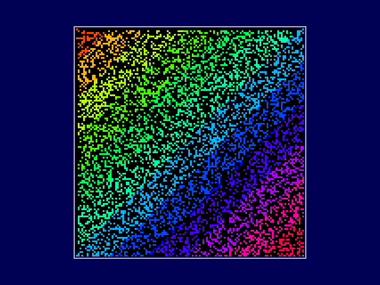
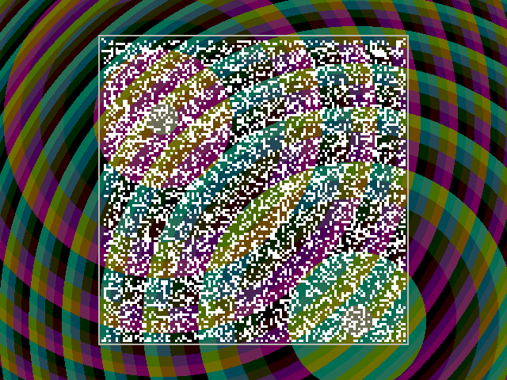
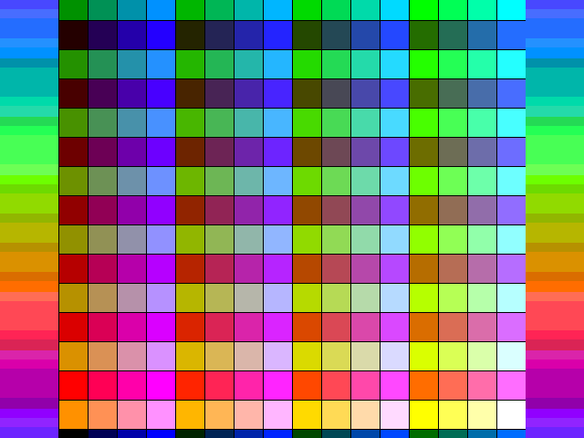
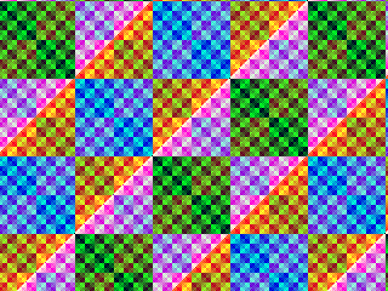

# Icey firmware & bring-up notes

Everything needed to build designs for the rev-1 Icey board and load them over
USB, plus what was learned bringing up the real hardware (Oct 2026).

```
firmware/
├── README.md            this file
├── life-demo.sh         one-command showcase demo (Life + USB host + microSD; --vga adds a monitor)
├── icey.pcf             full pin constraints for the board
├── tools/
│   ├── setup.sh         one-time host setup (venv + udev rule)
│   ├── iceyprog.py      programmer for Icey's FTDI pinout
│   ├── ice2v.py         Icestudio project -> Verilog/PCF (no GUI)
│   └── 53-icey-ftdi.rules
├── examples/
│   ├── common.mk        shared Makefile rules
│   ├── blink/           LED1 blink + RGB cycle
│   ├── uart_flash/      UART echo, flash JEDEC ID, button (+ test.py)
│   ├── hwtest/          hardware-test bridge + hwtest.py (SD, USB host, buttons, LEDs)
│   ├── flashtest/       single vs quad SPI reads of the flash from the FPGA
│   └── icestudio/blink.ice
└── icestudio/           submodule: Icestudio fork with an "Icey" board
```

## Feature checklist: designed vs tested on the real board

Legend: **[x]** tested on the physical board · **[~]** partly tested ·
**[ ]** designed in, not yet tested on hardware · **✗** tested and doesn't work.
"Design" is what the schematic/netlist says should work; "Evidence" is what was
actually observed with the board plugged in (2026-10-12).

### Power, USB, programming

| | Feature (design) | Evidence on hardware |
|---|---|---|
| [x] | USB-C power, 3.3 V / 1.2 V regulators | FPGA, FTDI and flash all operate; rails checked with a multimeter |
| [x] | FT2232H USB bridge (`0403:6010`) | Enumerates, both channels appear (`ttyUSB0/1`) |
| [x] | Load FPGA over USB (SPI slave / SRAM) | CDONE 0→1; 40/40 loads in a stress test (`iceyprog.py`) |
| ✗ | Stock `iceprog` / openFPGALoader | FTDI pinout differs (CS=ADBUS3, CRESET=4, CDONE=5), see note 1 |
| [x] | Program SPI flash from the PC | JEDEC `ef 40 18`; 104 KB write + verify OK |
| ✗ | **FPGA boots from flash at power-up** | Never configures: SPI data lines crossed, see note 2 |
| [x] | Reset button SW3 | Pressed: CDONE 1→0 and LED2 lit (FPGA then stays blank, see ✗ above) |
| [ ] | Config SPI header J2 | Same bus the FTDI uses (which works); header itself untested |

### FPGA, clocks, I/O

| | Feature (design) | Evidence on hardware |
|---|---|---|
| [x] | iCE40UP5K logic, block RAM, `SB_RGBA_DRV` | All examples run; Life demo uses 8 BRAMs and 52% of the logic |
| [x] | Internal 48 MHz oscillator (no crystal on board) | Runs UART at 115200 and 3 Mbaud error-free |
| [x] | PLL (from internal oscillator) | Measured 25.055 MHz output (target 25.125) via UART timing |
| [x] | LED1 (pin 9) | Blink seen by user |
| [x] | RGB LED4 (pins 39–41) | Each lit alone: **RGB0 = red, RGB1 = blue, RGB2 = green** |
| [x] | LED2 "not configured" (CDONE) | Goes off when configured, seen by user |
| [x] | LED3 (FTDI BCBUS3) | Blinks when BCBUS3 is driven as GPIO (`hwtest.py led3`); active low |
| [x] | Button SW2 (pin 6) | Presses and releases detected; LED1 lit while held |
| [ ] | Header J1 (9 GPIO, 3V3, VBUS) | Untested |

### Peripherals

| | Feature (design) | Evidence on hardware |
|---|---|---|
| [x] | UART FPGA ⇄ PC (FTDI channel B) | 115200: 508 bytes, 0 errors. 3 Mbaud: Life demo moves ~2 KB snapshots continuously |
| [x] | QSPI flash from FPGA user logic | `examples/flashtest`: quad read (0x6B, IO0–IO3) matches single read on all 106,496 bytes of the stored bitstream; every IO line toggles; 5.97 vs 1.50 MB/s at 12 MHz SCK (4.0x). QE was already set at the factory |
| [ ] | VGA output (3/3/2-bit DAC + sync) | Not seen on a monitor. VGA demo simulated (exact 800×525 timing, clean blanking); real pixel clock measured (31.32 kHz / 59.65 Hz) |
| [x] | USB host (MAX3421E + USB-C peripheral port) | Rev 0x13, crystal OK; a Keychron C3 Pro (full-speed) enumerated (VID 3434/PID 0430, strings read), configured as a boot keyboard, and typed keys arrived correctly on the PC |
| [x] | microSD card (SPI, shared bus) | 62.5 GB SDHC card: init in 0.29 s, CID/CSD read, sector reads at 6 MHz, FAT32 file listing. **Write**: one unused sector (gap before the partition) written with random data, read back identical, original restored and verified (`hwtest.py sdwrite`) |

### Software / tooling

| | Feature | Evidence |
|---|---|---|
| [x] | `tools/setup.sh` (venv + udev) | Run on the dev machine; udev rule needs a replug |
| [x] | `examples/blink`, `examples/uart_flash` (`make prog`) | Built and run on the board |
| [x] | Icestudio fork, *Icey* board, build | User built `blink.ice` in the GUI |
| [x] | Icestudio Upload button | Clicked in the GUI: `blink.ice` built and loaded onto the board, LEDs confirmed by user |
| [x] | `examples/icestudio/life.ice` + `life.py` | 178k gen/s; 19,889–20,041 generations bit-exact vs NumPy |
| [x] | `examples/icestudio/showcase.ice` + `life-demo.sh` | Runs end to end: board check (USB host, keyboard, SD file listing, RGB); keyboard on the board steers the show (pause, speed, patterns, next act all seen working; quit checked with a scripted Esc); SW2 = new soup; bit-exact proof |
| [x] | `examples/hwtest` (`hwtest.py`) | All 7 tests run on the board (see Peripherals) |
| [~] | `examples/icestudio/vga_demo.ice` | Builds and loads; needs a monitor (see VGA above) |
| [~] | `examples/icestudio/showcase_vga.ice` + `life-demo.sh --vga` | Loads and runs the show on the board: Life bit-exact (18,061 gens), 178,766 gen/s, SD/USB host/RGB board check, VGA scene command acks. VGA frames checked in simulation only; needs a monitor |

**Practical upshot:** the board works, but your design must be reloaded over USB
after every power-up (flash boot is broken on rev 1).

## Quick start (Linux)

```sh
firmware/tools/setup.sh                # once: venv + udev rule (asks for sudo)
# unplug/replug the programming USB-C (USB2) after the udev rule is installed

cd firmware/examples/blink
make prog                              # build + load into FPGA SRAM
```

`make prog` prints `CDONE = 1 -> configured` on success. LED1 blinks, the RGB
LED cycles and LED2 (the "not configured" LED) turns off.

To talk to the FPGA's UART:

```sh
cd firmware/examples/uart_flash && make prog
~/.local/share/icey/venv/bin/python test.py
```

## Tools you need

| Tool | What for | Installed by |
|---|---|---|
| Python 3 + [`uv`](https://docs.astral.sh/uv/) (or `python3-venv`) | venv for everything below | you |
| `pyftdi` | `iceyprog.py` drives the FT2232H over libusb | `setup.sh` |
| `yowasp-yosys`, `yowasp-nextpnr-ice40` (includes `yowasp-icepack`) | synthesis / place & route / bitstream (no root needed) | `setup.sh` |
| udev rule `53-icey-ftdi.rules` | lets non-root users open the FT2232H (`0403:6010`) | `setup.sh` (sudo) |
| `dialout` group (optional) | use the UART as `/dev/ttyUSB1` from a terminal | `sudo usermod -aG dialout $USER` |
| Node.js ≥ 24 (optional) | run the Icestudio fork from source | you |

System packages (`yosys`, `nextpnr-ice40`, `fpga-icestorm`) or the
[OSS CAD Suite](https://github.com/YosysHQ/oss-cad-suite-build) work too. The
Makefiles fall back to them if the venv isn't there. **Don't use their `iceprog`**,
see below.

The venv lives at `~/.local/share/icey/venv` (override with `ICEY_VENV`). The
Icestudio board looks for it there.

## Hardware tests (`examples/hwtest`)

A UART→SPI bridge bitstream plus a Python script that tests the peripherals
from the PC. These produced the checklist evidence above.

```sh
cd firmware/examples/hwtest && make prog
PY=~/.local/share/icey/venv/bin/python
$PY hwtest.py bus      # MAX3421E alive + SPI bus (no equipment)
$PY hwtest.py sd       # microSD: init, card ID, capacity, sector 0, file list (read-only)
$PY hwtest.py sdwrite  # write test on one unused sector (backed up, restored, verified)
$PY hwtest.py usb      # USB keyboard: enumerate, then echo what you type (Esc ends)
$PY hwtest.py button   # SW2
$PY hwtest.py rgb      # lights RGB0/1/2 in turn
$PY hwtest.py led3     # blinks LED3 via FTDI GPIO
$PY hwtest.py sw3      # press reset (run last: wipes the design)
```

Flash quad mode has its own design: `cd examples/flashtest && make prog && $PY flashtest.py`.

The USB test is a minimal USB host stack (enumeration, control transfers,
boot-protocol keyboard) running in Python, talking to the MAX3421E through the
FPGA. Bridge protocol: see the header of `top.v`.

## iceyprog.py

```
iceyprog.py sram  design.bin   load into FPGA SRAM (what you normally want)
iceyprog.py flash design.bin   write + verify SPI flash (FPGA can't boot it on rev 1)
iceyprog.py id                 read the flash JEDEC ID (should be ef 40 18)
iceyprog.py status             print CDONE
iceyprog.py reset              pulse CRESET_B
```

Options: `--freq` (SPI clock in Hz, default 6 MHz; 15 MHz tested OK), `--url`
(pyftdi URL, default `ftdi://ftdi:2232h/1`). It exits non-zero if CDONE doesn't
go high.

## Board notes from bring-up

### 1. FTDI pinout ≠ iceprog's — why earlier attempts failed

FT2232H **channel A** (MPSSE) is wired to the FPGA/flash SPI bus through solder
jumpers JP1–JP6 (bridged by default):

| FT2232H | Net | Goes to |
|---|---|---|
| ADBUS0 | SCK | FPGA 15, flash 6 |
| ADBUS1 | MOSI | FPGA 17 (SPI_SI), flash 5 (DI) |
| ADBUS2 | MISO | FPGA 14 (SPI_SO), flash 2 (DO) |
| ADBUS3 | CS | FPGA 16 (SPI_SS), flash 1 (via R35 0Ω) |
| ADBUS4 | CRESET_B | FPGA 8 (10k pull-up R20, button SW3 to GND) |
| ADBUS5 | CDONE | FPGA 7 (10k pull-up R21, LED2) |

Stock `iceprog` (and openFPGALoader's iCE40 profiles) hard-code the
iCEstick/iCEBreaker layout: **CS = ADBUS4, CDONE = ADBUS6, CRESET = ADBUS7**.
On Icey that toggles the FPGA's CS line as if it were reset, and never touches
the real CRESET_B, so the FPGA is never configured. openFPGALoader's `--pins`
can only remap the four SPI lines, not reset/done. That's why `iceyprog.py`
exists.

FT2232H **channel B** is a plain UART to the FPGA (JP7/JP8):
FPGA pin 46 = RX (PC→FPGA, net `PROG_TX`), pin 47 = TX (FPGA→PC, net `PROG_RX`).
Net names are from the FTDI's point of view. There's no EEPROM, so both channels
come up as `ttyUSB0`/`ttyUSB1`. `iceyprog.py` detaches `ttyUSB0` while it runs.

### 2. Flash boot is broken (rev-1 design bug)

Observed: flash programs and verifies, but after releasing CRESET_B (with the
FTDI fully tri-stated) the FPGA clocks SCK and retries forever. CDONE never rises.

Cause: the iCE40 always outputs on **SPI_SO (pin 14)** and inputs on
**SPI_SI (pin 17)**. When it boots as SPI master it needs SO→flash DI and
flash DO→SI. On Icey, pin 14 is tied to flash **DO** and pin 17 to flash **DI**.
That's correct for the FTDI loading the FPGA in slave mode (which is why SRAM
loading works) but backwards for the FPGA booting from flash.

Fix options:
- **Rev 2:** swap the nets at FPGA pins 14/17, so FTDI MOSI → flash DI + FPGA
  pin 14, and FTDI MISO ← flash DO + FPGA pin 17, like the iCEBreaker. Flash
  programming from the FTDI and flash boot then both work. Check the Lattice
  UP5K breakout's J6 jumper scheme if you also want FTDI→SRAM loading on the
  same wiring.
- **Rework this board:** lift flash pins 2 and 5 and cross-wire them. Flash boot
  works, but the FTDI can then only write the flash by bit-banging (MPSSE's data
  out is fixed on ADBUS1). `iceyprog.py` would need a swapped-pin mode.
- **Do nothing:** load over USB each time (current workflow).

From **user logic** the flash is fully usable: `icey.pcf` already assigns
`FLASH_MOSI` = pin 17 and `FLASH_MISO` = pin 14 (verified by reading the JEDEC ID
from the FPGA). WP/HOLD are wired to pins 12/11, so quad mode is possible.

### 3. SRAM loading sequence (what iceyprog does)

1. Drive CRESET_B low **first**, then CS low.
2. Release CRESET_B with CS still low. That selects SPI slave mode. Wait >1.2 ms.
3. CS high, 8 dummy clocks, CS low, stream the bitstream, CS high, ≥49 clocks.
4. Check CDONE.

Gotcha found on hardware: asserting CS *before* CRESET_B makes loads fail
whenever the FPGA is unconfigured. It's sitting in its failed flash-boot retry
loop, driving SCK/CS itself. The failure looked random but was 100% reproducible
(load `uart_flash`, then any other design). With reset first: 40/40 loads passed
across every state transition. CS is shared with the flash, so the flash also
sees the bitstream; its first byte is `0xFF`, which the flash ignores.

### 4. Other hardware facts worth knowing

- **No external FPGA clock.** Use `SB_HFOSC` (48 MHz, divisible down to 12 MHz;
  all examples use 12 MHz). It's roughly ±10% accurate: 115200 baud UART worked
  fine. Fussy VGA monitors may want a real oscillator into **header P4 (FPGA 35,
  global buffer G0)**.
- **LED1** (pin 9) is active high.
- **LED2** is wired from +3V3 to CDONE, so it's **on while the FPGA is NOT
  configured**.
- **LED3** hangs off FTDI BCBUS3 (active low). The FTDI has no EEPROM, so it
  doesn't act as a TX/RX activity LED; it lights only when BCBUS3 is driven as GPIO.
- **RGB LED4**: common anode on **VBUS (5 V)**, cathodes on the open-drain RGB
  pins 39/40/41 (active low). Use `SB_RGBA_DRV` (current-limited); a plain output
  also builds and works open-drain. **RGB0 (39) = red, RGB1 (40) = blue,
  RGB2 (41) = green.**
- **SW2** (pin 6) is active low with a 10k pull-up. **SW3** pulls CRESET_B low,
  which reloads from flash, which fails, so the FPGA is left blank.
- **SD card and MAX3421E share one SPI bus** (SCK 44, MOSI 48, MISO 45). Separate
  CS: SD 10, USB 2. The MAX3421E powers up in half-duplex SPI mode: set
  `FDUPSPI` in PINCTL first so it tri-states MISO properly. Host-only registers
  (e.g. PERADDR) read back 0 until MODE.HOST is set. It has its own 12 MHz
  crystal; RES# on pin 3, INT on pin 4. The host port gets 5 V via fuse F1 and
  advertises as a source (56k Rp on CC).
- **VGA DAC**: R/G are 3-bit (510/1k/2k), B is 2-bit (430/820). Full scale is
  about 0.7 V into 75 Ω. See `icey.pcf` for the bit order.

### 5. Bring-up log (2026-10-12)

1. FT2232H enumerates (`0403:6010`), `ttyUSB0/1` appear.
2. libusb access denied: installed udev rule, needed a **replug** (`udevadm
   trigger` alone didn't apply the mode).
3. Flash JEDEC ID `ef 40 18` with the FPGA held in reset: FTDI, SPI bus, flash
   and 3.3 V all good.
4. SRAM load of blink: CDONE 0→1, LEDs behave. Power, 1.2 V core, PLL supply and
   FPGA all good.
5. Flash write + verify OK; boot from flash fails even with the FTDI pins
   tri-stated. Traced to the SO/SI swap above.
6. UART echo: 508 bytes, 0 errors. FPGA-side flash read: `ef 40 18`. Button reads
   correctly.
7. Fixed the CS-before-reset ordering bug in `iceyprog.py`; 40/40 load stress test.

## Icestudio

`firmware/icestudio` is a fork of [FPGAwars/icestudio](https://github.com/FPGAwars/icestudio)
(branch `icey`) that adds an **Icey** board under *UP5K*:

- `app/resources/boards/Icey/`: pinout (same names as `icey.pcf`, VGA bits
  flattened to `VGA_R2`…), `rules.json` (empty, since there's no board clock),
  and an upload hook.
- **Build** uses apio with the generic `ice40-up5k` target (same FPGA/package).
- **Upload** runs `apio build`, then `icey-upload.sh`, which calls the bundled
  copy of `iceyprog.py` to load SRAM. It finds Python+pyftdi via `$ICEY_PYTHON`,
  then `~/.local/share/icey/venv`, then `python3`, so run `tools/setup.sh` first.

Run it from source:

```sh
git submodule update --init firmware/icestudio
cd firmware/icestudio
npm install          # downloads NW.js + deps (large)
npm start
```

Then choose **Select → Board → UP5K → Icey**, open
`firmware/examples/icestudio/blink.ice`, and hit **Upload**. Because there's no
board clock, drop in a Verilog code block with `SB_HFOSC` (the example does this
and also exports `clk_out`).

### Showcase (`examples/icestudio/showcase.ice`): the one-command demo

```sh
./firmware/life-demo.sh          # add --loop for kiosk mode
```

It installs the tools on first run, builds `showcase.ice` (using
`tools/ice2v.py`, no Icestudio needed; cached after the first build), loads it,
and plays a full-screen show (`life_show.py`):

1. **Board check**: USB host controller, the keyboard plugged into the board
   (maker/product read over USB), the microSD card (size, model, and its FAT32
   file list), an RGB sweep. All of it is reached through the FPGA.
2. **Primordial soup** and **glider gun**, cells coloured by age.
3. **From your microSD**: plays any `.rle` Life patterns in the card's root
   (skipped if there are none).
4. **Off the leash**: flat-out benchmark vs NumPy on the PC.
5. **Proof**: ~20,000 generations checked cell for cell.

**Controls** (keyboard plugged into the *board's* USB-C port): `space` pause,
`r` new soup, `g`/`a`/`p` glider gun / acorn / R-pentomino, `s` next SD pattern,
`+`/`-` speed, `n` next act, `t` typing test, `esc` quit. **SW2** = new soup.

**Typing test** (`t` in the show, or `./firmware/life-demo.sh --typing`): a
Monkeytype-style test (15/30/60 s, WPM, raw, accuracy, per-second chart) where
every keystroke comes from the keyboard on the *board*, through the MAX3421E
USB host and the FPGA. The RGB LED is green while you're on track and red on a
mistake, SW2 restarts, and the results show how many Life generations the FPGA
ran in the background while you typed. The RGB LED shows
the state: blue = watching, red = flat out, green = proof passed.

The design is the Life engine below plus the `hwtest` I/O bridge, behind a
command router that shares the one 3 Mbaud link: `S L V N` go to Life, `X Y C D I`
to the bridge. 58% of the logic cells, 9/30 block RAMs, timing 34 MHz vs 24 MHz.
Use a truecolor terminal; at ≥172×70 the grid is one block per cell,
otherwise braille.

### Showcase + VGA (`examples/icestudio/showcase_vga.ice`)

```sh
./firmware/life-demo.sh --vga    # same show, plus a VGA monitor on the board
```

The same showcase (everything above still works) plus the VGA port: the
**live Life grid** in the middle of the screen (3×3 pixels per cell, 384×384)
while the FPGA cycles through colour schemes and the racing-the-beam effects
from `vga_demo.ice` on its own, about 70 s per loop:

| # | Scene | # | Scene |
|---|---|---|---|
| 1 | Life, rainbow cells drifting across the board | 5 | Life over the interference |
| 2 | plasma | 6 | interference |
| 3 | Life over the plasma | 7 | all 256 colours the DAC can make |
| 4 | XOR fractal | 8 | Life, rainbow cells over the XOR fractal |

The show's `v` key steps through the scenes one at a time, then back to cycling.

| Life, rainbow | Life over plasma | Life over interference | All 256 colours |
|---|---|---|---|
|  |  |  |  |

How it fits together:
- Two clock domains: the Life engine, UART and I/O bridge stay at 24 MHz
  (HFOSC / 2); the PLL makes the 25.125 MHz pixel clock from that.
- Block RAM has one read port, and the engine uses it. So every row the engine
  (or a PC `L` load) writes is also written into a 2 KB display copy. Its write
  side runs at 24 MHz and its read side at 25 MHz. The beam fetches one row per
  scan line during blanking, so the engine never waits for the display.
- Command `G s` on the I/O bridge: scene 0–7 to hold one, 255 to cycle
  (the power-up default) → `k`.
- Fits at 95% of the logic cells, 17/30 block RAMs, 4/8 DSPs. The interference
  effect's 4 multipliers are `SB_MAC16` blocks instantiated directly, because
  apio (Icestudio) doesn't synthesise with `-dsp` and the LUT multipliers would
  need 106%. Timing: 29 MHz vs 24, 31.5 MHz vs 25.1.

Verified: the VGA half (timing, 4 effects, Life layer, director, compositor)
simulated with Yosys CXXRTL against a monitor model that syncs on HSYNC/VSYNC.
Every one of the 16,384 cells lands on its 3×3 block, nothing is drawn during
blanking in any of the 8 scenes, and the director's schedule was checked over
6,000 frames. The previews above are those frames. On the board: the show runs
end to end with `--vga`, Life is bit-exact, and the speed is unchanged.
**Not yet seen on a real monitor.**

### Game of Life (`examples/icestudio/life.ice` + `life.py`): no monitor needed


Conway's Life on a 128x128 wrap-around grid. The grid streams back to the PC
over the same USB cable (FT2232H channel B, 3 Mbaud), so all you need is the
board. The "Life rule x128" block is **128 copies of the rule in hardware**,
computing a whole row every clock. Grid in block RAM, double-buffered, 24 MHz.

```sh
# upload life.ice from Icestudio, then (venv from tools/setup.sh):
PY=~/.local/share/icey/venv/bin/python
$PY examples/icestudio/life.py                     # watch it (--pattern gun|acorn|rpent)
$PY examples/icestudio/life.py --bench             # measure flat-out speed
$PY examples/icestudio/life.py --verify            # check every cell vs NumPy
```

Measured on the board:
- `--bench`: **178,540 generations/s = 2.93 billion cell updates/s** (134
  clocks per generation), 17x faster than NumPy on the host PC.
- `--verify`: the upload, 5 single steps and **19,889 generations run flat out
  all match the NumPy reference cell for cell.**
- Also simulated in iverilog against the same reference. apio build: 52% of
  logic cells, 8/30 block RAMs, timing 42 MHz vs 24 MHz needed (48 MHz didn't
  leave enough margin for the internal oscillator's ±10%).

Protocol (if you want to write your own client): `S` → 4-byte generation
counter + 2048-byte grid; `L` + 2048 bytes → load grid; `V n` → speed (0 =
flat out, 255 = stop, else n×65536 clocks per generation); `N` → single step.
`L`, `V` and `N` reply `k`. Grid bytes: rows 0–127, 16 bytes per row, bit x =
column x.

### VGA demo (`examples/icestudio/vga_demo.ice`): why FPGAs

A "racing the beam" demo for the on-board VGA port. Seven Icestudio blocks run
in parallel. Every pixel of 640x480@60 is **computed live as the monitor draws
it**: 25 million pixels per second, no framebuffer, no CPU. **SW2** cycles
through the effects. All three are computed every clock; the output block
just picks one.

| Plasma: 7 sine lookups/pixel | XOR fractal | Interference: 4 multiplies/pixel |
|---|---|---|
|  |  |  |

Blocks: 25 MHz pixel clock (HFOSC → PLL) → VGA timing → 3 effect pipelines
(3-clock latency each) → effect select + output (sync delayed 3 clocks to
match). Button debounce and the LED heartbeat run alongside.

Verified:
- Simulated with iverilog against a "monitor" model that syncs on HSYNC/VSYNC.
  800 clocks/line, 525 lines/frame, zero non-black pixels in blanking for all
  3 effects. The preview images above are those simulated frames, rendered at
  the board's 8-bit colour depth.
- Button simulation: each press advances one effect (0→1→2), holding doesn't
  repeat.
- Built through apio exactly as Icestudio does: 33% of logic cells, timing 31.6
  MHz vs 25.125 MHz needed.
- On the board: measured the HFOSC→PLL pixel clock at **25.055 MHz** (hsync
  31.32 kHz, vsync 59.65 Hz; VGA spec 31.47 kHz / 59.94 Hz).
- **Not yet seen on a real monitor.**

Tested: the board's exact build+upload command chain (apio 1.6 `build` with
`board = ice40-up5k`, then the upload hook) built and configured the FPGA, and
the example's code block compiles and runs on the board. **Not yet tested:**
clicking through the Icestudio GUI itself.

Keep `icestudio/app/resources/boards/Icey/iceyprog.py` in sync with
`tools/iceyprog.py` (the fork must be self-contained).
